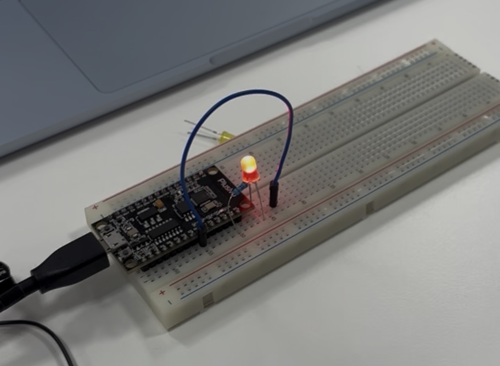

# Kod med förklaring
När man skriver kod för till exempel mikro kontrollers så använder man C++ alltså en språkvariant av __source kod__ (käll kod).

Denna kod som man skriver måste man sedan omvandla till språk så att datorn förstår det som __object kod__ (1:or och 0:or), denna omvadnling heter __compile__ (kompilera).

## Vad vi ska utföra

Här kommer en enkel kod förklaring till hur man kodar en LED-lampa som blinkar efter 500ms via den inbyggda lampan på mikrokontroller.

## Setup
Först startar man med en så kallad "setup".

Kopierbart exempel:
```C++
void setup() {
    pinMode(LED_BUILTIN, OUTPUT);
    Serial.begin(115200);

}
```

| Kod namn | Förklaring |
| --- | --- |
| __void__ | Ett kommando som ger inget resultat tillbaks |
| __pinMode__ | Bestämmer hur pinnen används |
| __LED_BUILTIN__ | Inbyggda LED-lampan |
| __OUTPUT__ | Skickar ut signalen |
| __Serial.begin__ | Kommunikationen och att den startar |
| __(115200)__ | Kommunikationshastigheten |

## Loop
Sedan följs det upp med en så kallad "loop".

Kopierbart exempel:
```C++
void loop() {
  digitalWrite(LED_BUILTIN, HIGH);
  delay(500);
  digitalWrite(LED_BUILTIN, LOW);
  delay(500);
}
```

| Kod namn | Förklaring |
| --- | --- |
| __digitalWrite__ | Skickar signalen till en pinne |
| __LED_BUILTIN__ | Den integrerade lampan på kontrollen |
| __Delay__ | Pausar programet en stund |
| __500__ | 500 ms väntan |
| __HIGH__ | LED av |
|__LOW__ | LED på |


### Viktigt att tänka på:
I detta fallet kodar man för den inbyggda LED lampan och då betyder HIGH att släcka lampan och LOW att tända lampan. Man kan ibland förväxla det att de gör motsatta saker på grund av deras namn.

Man kan även använda siffrorna 0 och 1, för att tända och släcka lampan.

Efter varje kod kommando ska man skriva " ; " för att slutgöra kommandot

Såhär kan en krets och lampa som blinkar ser ut:


